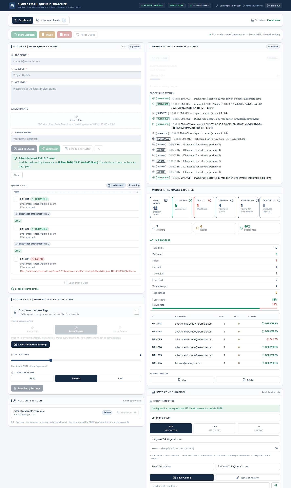
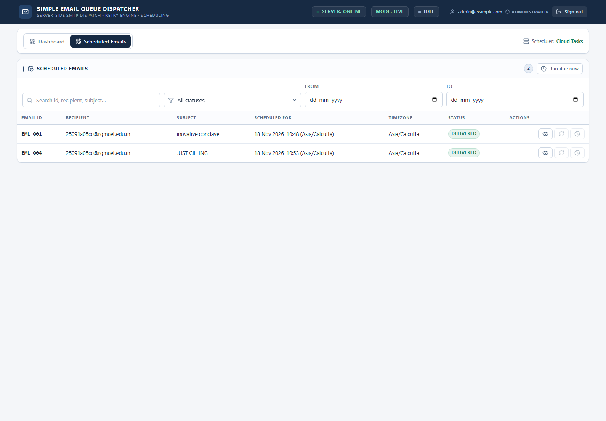

# Email Queue Dispatcher

> A **real SMTP email dispatcher** with a bounded retry engine.
> React + TypeScript (Vite) in the browser, Firebase Cloud Functions + Firestore +
> Nodemailer on the server.
>
> Add emails → the dispatcher drains them **FIFO** → sends them over **real SMTP** →
> the delivery status of every attempt streams back live → failures are retried
> automatically → the whole run is exportable as a report.

[](LICENSE)
[](https://github.com/IMTTY-ok/simple-email-queue-dispatcher/actions/workflows/ci.yml)


---

## Table of contents

1. [What it does](#1-what-it-does)
2. [Screenshots](#2-screenshots)
3. [The modules](#3-the-modules)
4. [Tech stack](#4-tech-stack)
5. [Quick start — 5 minutes](#5-quick-start--5-minutes)
6. [Accounts and roles](#6-accounts-and-roles)
7. [Configuration — what to fill in, and why](#7-configuration--what-to-fill-in-and-why)
8. [How to use the dashboard](#8-how-to-use-the-dashboard)
9. [Deploying](#9-deploying)
10. [Project structure](#10-project-structure)
11. [How the dispatcher works](#11-how-the-dispatcher-works)
12. [API reference](#12-api-reference)
13. [Data model](#13-data-model)
14. [Testing](#14-testing)
15. [Scripts](#15-scripts)
16. [Troubleshooting](#16-troubleshooting)
17. [Security](#17-security)
18. [Contributing](#18-contributing)
19. [License](#19-license)

---

## 1. What it does

```
   ┌──────────────────────────┐   realtime listeners   ┌────────────────────────┐
   │  React dashboard         │◄───────────────────── │  Firestore             │
   │  :5173                   │  emails · activity ·  │  emails · activity ·   │
   │  useEmailDispatcher hook │  stats · _meta        │  stats · _meta         │
   └───────────┬──────────────┘                       └───────────▲────────────┘
               │  REST /api/*                                       │ Admin SDK writes
               ▼                                                   │
   ┌──────────────────────────┐                        ┌────────────────────────┐
   │  Cloud Function          │──── SMTP (250 / 550)───►│  Your mail server      │
   │  `backend`               │                        │  Gmail · Outlook · …   │
   │  Express + Nodemailer    │◄───────────────────────│                        │
   └───────────┬──────────────┘   550 / timeout        └────────────────────────┘
               │
               │  Cloud Tasks queue (Module 6)
               ▼
   ┌──────────────────────────┐
   │  `scheduledDispatch`     │  fires at the scheduled moment
   │  `scheduledSweep`        │  the safety net
   └──────────────────────────┘
```

The queue is strictly FIFO, every attempt is recorded, and a failed delivery is
retried up to a configurable limit before it is marked `FAILED`.

An email can be delivered **immediately** or **at a chosen moment**. The
scheduled delivery is triggered by Google Cloud Tasks, so it goes out whether
or not the dashboard is open.

An email may also **carry files** — PDF, Office documents, images and video.
The bytes live in Cloud Storage and are attached to the message when the
dispatcher delivers it; the email document only keeps a small descriptor per
file. See [3.1](#31-attachments).

---

## 2. Screenshots

> Captured from the running emulator. The dashboard is live — every counter,
> badge and log line updates in real time through Firestore listeners.

### The dashboard



The whole board at a glance: the header with its live state, the control
toolbar, the five modules and the activity log. The queue is visualised from
FRONT to REAR, and a queued email can be removed with one click.

### Scheduled deliveries



The Scheduled Emails tab: every delivery, its timezone, the local time it is
due for, the UTC instant and the time left. A scheduled email can be
cancelled or rescheduled from this table.

More captures (sign-in screen, mobile viewports, the scheduling panel and
the responsive sweep) live in [`docs/screenshots/`](docs/screenshots/).

---

## 3. The modules

The application is organised into the modules of the product requirements
document. Each module owns its own UI, its own client hook and — where it needs
one — its own server-side service. The frontend and the backend use the same
folder names, so a feature is easy to follow across the whole stack.

Module 6 — *Scheduled Delivery* — was added later and is described in
[3.6](#6--scheduled-delivery).

### 1 · Email Queue Creator

*Responsible for creating and storing email tasks.*

- Add an email with a validated recipient, subject and message
- **Attach files** — PDF, Word, Excel, PowerPoint, images and video, straight
  from your machine (see [3.1](#31-attachments) below)
- Unique IDs are generated automatically (`EML-001`, `EML-002`, …)
- The queue position of a new email is reported back immediately
- Empty emails are refused; the form clears after a successful add
- The FIFO queue is visualised from FRONT to REAR, and a queued email can be removed

`src/modules/module-1-email-queue-creator/` · `functions/src/modules/module-1-email-queue-creator/`

#### 3.1 Attachments

An email may carry files. They are **not** part of the message body and they
do not travel through the API — the bytes live in Cloud Storage and the email
document only carries a small descriptor per file.

| | |
| --- | --- |
| **Where the bytes live** | Cloud Storage, under `attachments/{uid}/{batch}/{file name}` |
| **How they get there** | The browser uploads them straight to the bucket, with a progress bar |
| **Where the rules live** | The server — the browser asks `GET /api/attachments/config` and shows the same limits |
| **What may be attached** | PDF, Word, Excel, PowerPoint, plain text, images and video (33 extensions) |
| **How much** | 10 files per email, 16 MB per file, 16 MB in total |
| **When they are removed** | Once the email has been delivered, failed or was removed from the queue |
| **Who may attach what** | A signed-in account may only write into its own folder — see `storage.rules` |

The limits keep a message below the 25 MB ceiling every mail server enforces
(attachments are base64-encoded on their way through SMTP, which grows them by
a third).

> **Why Storage and not the API?** A Firestore document is capped at 1 MiB and
> a video is far larger than that. Uploading through the Cloud Function would
> also put the bytes through a 512 MB function on every single file. The
> browser therefore uploads straight to the bucket, and the Storage rules
> (`storage.rules`) are the boundary around it.

### 2 · Send Simulator

*Determines whether a delivery attempt succeeds or fails.*

- **Real SMTP** through Nodemailer — Gmail (App Password), Outlook, Zoho, any relay
- **Dry-run simulator** with the three modes:
  - `AUTOMATIC` — pseudo-random success/failure
  - `FORCE_SUCCESS` — every attempt succeeds
  - `FORCE_FAILURE` — every attempt fails, so the retry engine can be demonstrated
- *Test Connection* and *Send a test email* validate the credentials before you dispatch

`src/modules/module-2-send-simulator/` · `functions/src/modules/module-2-send-simulator/`

### 3 · Retry Logic Engine

*The main logic of the project.*

- A failed email is retried up to `retryLimit` times
- `retryLimit = 3` → 1 initial attempt + 3 retries = **4 total attempts**
- The limit is configurable from the dashboard (0–10) and is clamped server-side
- Backoff between attempts, plus a processing speed (Slow / Normal / Fast)
- Start / Pause / Resume / Stop / Reset — pausing is cooperative and requeues the
  in-flight email, so nothing is ever stranded off-queue

`src/modules/module-3-retry-logic/` · `functions/src/modules/module-3-retry-logic/`

### 4 · Final Status Logger

*Maintains the complete history of every email.*

- Every attempt is appended to the email document: attempt number, result, detail, timestamp
- Every transition is written to a global activity log, rendered live in the dashboard
- The final status (`DELIVERED` / `FAILED`) and the retry count are recorded per email

`src/modules/module-4-final-status-logger/` · `functions/src/modules/module-4-final-status-logger/`

### 5 · Summary Exporter

*Summary dashboard and an exportable dispatch report.*

- Live statistics: total, queued, sending, delivered, failed, attempts, retries, success/failure rate
- A results table with the final status of every processed email
- Export the whole report as **CSV** or **JSON**, including the SMTP response and
  the error detail of every attempt

`src/modules/module-5-summary-exporter/` · `functions/src/modules/module-5-summary-exporter/`

### 6 · Scheduled Delivery

*Server-side delivery of an email at a chosen moment.*

- Schedule a single email for a future date, time and **IANA timezone**
- Schedule many emails independently of one another
- See every upcoming delivery, its remaining time and its status
- Cancel a scheduled delivery, or move it to another moment
- The delivery runs on the **server** — the dashboard, the browser and the
  laptop may all be switched off when the moment arrives
- The scheduled email travels through the **same** dispatcher, the **same**
  retry engine and the **same** status log as an immediate one

The trigger is a **Google Cloud Tasks** queue. The task carries only the
email id and a schedule version; the email itself stays in Firestore, and the
SMTP credentials are never part of the task.

| Guarantee | How it is met |
| --- | --- |
| Never too early | The server compares its own clock with `scheduledAt` inside the claim transaction. A task that arrives early is answered with *503* and retried. |
| Never twice | The claim is a Firestore transaction that moves the email from `SCHEDULED` to `SENDING`. Exactly one execution can win it. |
| Never a cancelled email | A cancelled email is no longer `SCHEDULED`, so it cannot be claimed. |
| Never a stale task | A reschedule bumps `scheduleVersion`; a task carrying the older version is refused. |
| Never before the queue | A scheduled email is **not** `QUEUED`, so the FIFO dispatcher cannot pick it up early. |

`src/modules/module-6-scheduled-delivery/` · `functions/src/modules/module-6-scheduled-delivery/`

See [7.6](#76-scheduled-delivery--the-cloud-tasks-setup) for the setup and
[14](#14-testing) for the tests.

---

## 4. Tech stack

| Layer | Technology | Why |
| --- | --- | --- |
| Frontend | React 19 + TypeScript 6 | Component model with full type safety over the whole domain model |
| Build tool | Vite 8 | Instant dev server, and a production build in under a second |
| Styling | Tailwind CSS 3 | One consistent design system without a CSS-in-JS runtime |
| Icons | Lucide React | Tree-shakeable, consistent icon set |
| State | React hooks | The dashboard is a single page driven by one realtime stream — no store needed |
| Realtime data | Firestore `onSnapshot` | The server pushes state; the client never polls |
| Backend | Cloud Functions (Node 20) + Express 4 | One HTTPS function hosting the whole API |
| Database | Cloud Firestore (Admin SDK) | The queue survives restarts and cold starts |
| Email transport | Nodemailer 10 | Works with Gmail, Outlook, Zoho, any SMTP relay |
| Linting | oxlint | Fast, and no ESLint config to maintain |
| Testing | Node's built-in test runner | No test-framework dependency to install |

---

## 5. Quick start — 5 minutes

### Prerequisites

- **Node.js 22.12 or newer** — check with `node --version`
- An SMTP account — *only* if you want to send real email. Dry-run mode needs none.
  For Gmail: enable 2FA → **App Password** at
  `myaccount.google.com → Security → App passwords`.

### Install

```bash
git clone https://github.com/IMTTY-ok/simple-email-queue-dispatcher.git
cd simple-email-queue-dispatcher

npm install          # the dashboard
npm run dev:setup    # the Cloud Function (installs functions/ dependencies)
```

### Run

```bash
npm run dev
```

That single command starts **two** things side by side:

| What | Where | What it is |
| --- | --- | --- |
| The dashboard | <http://localhost:5173> | Vite dev server, hot reload |
| The backend + database | <http://127.0.0.1:5001/email-dispatcher-43118/us-central1/backend> | Firebase emulator |
| Emulator UI | <http://localhost:4000> | Inspect the Firestore data live |

The Vite dev server proxies `/api/*` to the emulator, so **you need no
environment variables for local development**. Open
<http://localhost:5173> and you should see the sign-in screen. Register the
first account — it becomes the administrator — and the dashboard appears
with a green **Server** badge. See
[Accounts and roles](#6-accounts-and-roles).

> The emulator needs a moment on first run while it downloads the Firestore
> binary. If the function fails to appear, see
> [Troubleshooting](#16-troubleshooting).

### Try it in 30 seconds

1. Click **Load Demo Data** — five sample emails enter the queue.
2. Click **Start** — the queue drains from FRONT to REAR and the counters move.
3. Watch the **Activity Log** — every transition is logged live.

Nothing was really sent, because the demo project runs in **dry-run** mode. See
[How to use the dashboard](#8-how-to-use-the-dashboard) to send real email.

### See the retry engine work

1. In **SMTP Dispatcher Settings**, enable **Dry-run** and pick
   **Force Failure**, then **Save Config**.
2. **Load Demo Data** and **Start**.
3. Each email fails four times (1 attempt + 3 retries) and ends as `FAILED`,
   with every attempt listed in the Processing panel and the Activity Log.

---

## 6. Accounts and roles

The dashboard is **not** an anonymous application. You sign in with a Firebase
Authentication account (email + password) before the queue is reachable at all,
and the access model has two roles.

| Role | May do |
| --- | --- |
| **Administrator** | Everything — SMTP configuration, connection tests, account management, the whole queue |
| **Operator** | Day-to-day use — enqueue, remove, dispatch, and read **their own** emails and activity |

### How the role is decided

- The **first account ever created** on an installation becomes the
  administrator. Every later account is an operator.
- The decision is made on the server, inside a transaction. A browser cannot
  promote itself — not through the API and not through the Firestore rules.
- An administrator can promote or demote other accounts from the
  **Accounts & Roles** panel in the dashboard. Nobody can change their own
  role, so an installation can never be locked out of its own configuration.

### Creating the first account

1. Start the app: `npm run dev`
2. Open <http://localhost:5173> — the sign-in screen appears
3. Click **Create account** and register any email and password
4. That account is now the administrator

The password field has a **show password** toggle — the eye icon on the right
of the field — so you can check what you typed without retyping it. It works
on the sign-in form and on the administrator's SMTP password field.

> In the Firebase console (production) enable **Authentication → Sign-in
> method → Email/Password**. The emulator needs no configuration.

### What the roles change in the interface

- An **operator** does not see the *SMTP Dispatcher Settings* panel at all — the
  SMTP mailbox and sender identity are administrator-only — and does not see
  the *Accounts & Roles* panel.
- An **operator** only sees the emails and activity they created.
- Both roles can enqueue, remove, dispatch, read the statistics and export a report.

### If you lock yourself out

The administrator role is stored in Firestore under `users/<uid>`. You can
promote an account from the Firebase console, or delete the `_meta/bootstrap`
sentinel document and register again — the next account created becomes the
administrator.

---

## 7. Configuration — what to fill in, and why

Everything configurable lives in exactly two places, plus one file you edit once.

### 7.1 `.firebaserc` — which Firebase project you use

```json
{
  "projects": {
    "default": "email-dispatcher-43118"
  }
}
```

| Field | What to fill in | Why you need it |
| --- | --- | --- |
| `default` | Your own Firebase project id (from the Firebase console → Project settings → Project ID) | The emulator, the CLI and the dev-server proxy all resolve the backend through this id. **Change this one field and the whole stack retargets** — you do not need to touch `vite.config.ts`. |

Leave it as-is to use the bundled demo project.

### 7.2 `.env.local` — the dashboard (browser side)

Copy the template and fill it in:

```bash
cp .env.example .env.local
```

| Variable | Required? | What to fill in | Why you need it |
| --- | --- | --- | --- |
| `VITE_API_URL` | **for deployments only** | `https://us-central1-<your-project>.cloudfunctions.net/backend` | Tells the browser where the API lives. Leave it **unset locally** — the dev proxy already forwards `/api` to the emulator. |
| `VITE_FIREBASE_API_KEY` | only with your own project | Firebase console → Project settings → Your apps → *SDK setup and configuration* → `apiKey` | The browser needs to identify the project in order to open the realtime listeners. It is a **public identifier**, not a secret — it is also readable from the shipped JavaScript. |
| `VITE_FIREBASE_AUTH_DOMAIN` | only with your own project | Same screen → `authDomain` (`<project>.firebaseapp.com`) | Required by the Firebase SDK to initialise. |
| `VITE_FIREBASE_PROJECT_ID` | only with your own project | Same screen → `projectId` | Selects the project the SDK talks to. Leave unset to use the value from `.firebaserc`. |
| `VITE_FIREBASE_STORAGE_BUCKET` | only with your own project | Same screen → `storageBucket` | The fallback bucket for the SDK. The API reports the bucket that actually holds the attachment files (`GET /api/attachments/config`), so this only matters when the server cannot resolve one itself. |
| `VITE_FIREBASE_MESSAGING_SENDER_ID` | only with your own project | Same screen → `messagingSenderId` | Same — the SDK expects the full config object. |
| `VITE_FIREBASE_APP_ID` | only with your own project | Same screen → `appId` | Identifies your web app inside the project. |
| `VITE_FIREBASE_MEASUREMENT_ID` | optional | Same screen → `measurementId` | Only used for Google Analytics. Leave blank to disable analytics. |

> **Never** put an SMTP password or a service-account key in a `VITE_` variable.
> Everything prefixed with `VITE_` is compiled into the browser bundle in plain
> text.

### 7.3 `functions/.env` — the backend (server side)

```bash
cp functions/.env.example functions/.env
```

The emulator reads this file automatically. `functions/.env` is gitignored.

| Variable | Required? | What to fill in | Why you need it |
| --- | --- | --- | --- |
| `SMTP_HOST` | for real sending | Your provider's server, e.g. `smtp.gmail.com` | The hostname the dispatcher connects to. |
| `SMTP_PORT` | for real sending | `587` (StartTLS) or `465` (implicit SSL) | Most providers want `587`; `465` is for implicit SSL. `25` is plaintext and almost never right. |
| `SMTP_SECURE` | for real sending | `false` with port 587, `true` with port 465 | Tells Nodemailer whether to wrap the socket in TLS immediately. |
| `SMTP_USER` | for real sending | The mailbox you log in with | The SMTP username. Usually the full address. |
| `SMTP_PASS` | for real sending | The app password / API token | **The only secret in the project.** Use an *app password*, never your account password. |
| `FROM_EMAIL` | recommended | The address recipients see | Defaults to `SMTP_USER`. Some providers refuse to send from an address they do not own. |
| `FROM_NAME` | optional | A friendly display name, e.g. `Email Dispatcher` | Shown in the recipient's inbox next to the address. |
| `RETRY_LIMIT` | optional | `3` (the default) | How many times a failed attempt may be repeated. The maximum number of attempts is this value **+ 1**. |
| `RETRY_DELAY_MS` | optional | `3000` | How long to wait before the next attempt. Give a real mail server room to recover from a transient failure. |
| `INTER_EMAIL_DELAY_MS` | optional | `1200` | The pause between two consecutive emails. Keeps you under most providers' rate limits. |
| `SMTP_DRYRUN` | optional | `true` to simulate, `false` to send for real | The safety switch. Leave it `true` while you are setting things up. |
| `SIMULATION_MODE` | optional | `AUTOMATIC`, `FORCE_SUCCESS` or `FORCE_FAILURE` | Only used while dry-run is on. `FORCE_FAILURE` is how you demonstrate the retry engine without breaking a real mailbox. |
| `ALLOWED_ORIGIN` | **for deployments** | `https://your-frontend.example.com` | Which browser origins may change state. See below — this one bites. |
| `STORAGE_BUCKET` | optional | Your bucket name, e.g. `my-project.firebasestorage.app` | The bucket the attachment files live in. Leave it unset and the project default is used — the browser is told the same name by the API, so the two never disagree. |

### 7.4 `ALLOWED_ORIGIN` — the one setting people get wrong

State-changing requests (`POST`, `PUT`, `PATCH`, `DELETE`) are refused with
**403** unless the browser's `Origin` header is in the allowlist. Reads are
always open.

| Situation | What to set |
| --- | --- |
| Local development | Nothing — the built-in default already covers `localhost:5173`, `localhost:4173` and the emulator UI. |
| Your own deployment | The exact origin of your deployed dashboard, e.g. `https://email-queue-dispatcher.vercel.app`. Several origins → comma-separated: `https://a.app,https://b.app`. |
| A domain you cannot change | Use the value the browser sends — the scheme and host, **without** a trailing slash and **without** a path. |

**Symptom of a wrong value:** the dashboard loads and the counters work, but
Start / Save / Add do nothing and the banner shows *"Origin not allowed"*. Fix
`ALLOWED_ORIGIN` on the function and reload.

### 7.5 `firebase.json`, `firestore.rules`, `storage.rules`, `firestore.indexes.json`

These are committed and need no editing to run locally.

| File | What it does | Why it matters |
| --- | --- | --- |
| `firebase.json` | Points the CLI at `functions/`, the rules and the indexes, and declares the emulator ports | The single place that ties the project together |
| `firestore.rules` | The browser may only **read**; every write goes through the Cloud Function. `_secrets/*` is denied to browsers entirely | This is why the SMTP password can never leak into the client. It is also the app's main security boundary — read the [Security](#17-security) section |
| `firestore.indexes.json` | The composite index the FIFO query needs (`status` + `seq`) | Without it Firestore rejects the "next queued email" query |
| `storage.rules` | The boundary around the attachment bucket: a signed-in account may only write into its own folder, capped in size and in content type | The attachment files never travel through the API, so these rules are what keeps one account from attaching another account's file |

### 7.6 Scheduled delivery — the Cloud Tasks setup

The scheduled delivery trigger is a **Google Cloud Tasks** queue. Cloud Tasks
calls the `scheduledDispatch` function at the exact moment a scheduled email
becomes due — no browser, no dashboard, no laptop involved.

**Nothing here is needed for the other five modules.** Without a task queue the
scheduling feature still works, but the delivery then depends on the periodic
*sweep* (see below).

#### Environment variables

| Variable | Required? | What to fill in | Why you need it |
| --- | --- | --- | --- |
| `SCHEDULE_TASK_SECRET` | **for Cloud Tasks** | A long random string, at least 16 characters | Signs every task payload. Without it nothing is queued — the feature fails **closed** rather than opening an unprotected endpoint. Generate one with `node -e "console.log(require('crypto').randomBytes(32).toString('hex'))"` |
| `CLOUD_TASKS_LOCATION` | optional | `us-central1` | The region of the queue. It must be the same region as the function that receives the task. |
| `CLOUD_TASKS_QUEUE` | optional | `email-scheduler` | The name of the queue. |
| `SCHEDULED_DISPATCH_URL` | optional | `https://us-central1-<project>.cloudfunctions.net/scheduledDispatch` | Only needed when the function is not reachable at its default address. |
| `SCHEDULE_SWEEP_TOKEN` | optional | A long random string | Lets an external cron call the `scheduledSweep` function with `X-Internal-Sweep-Token`. |
| `SCHEDULE_SWEEP_BATCH` | optional | `5` | How many due emails one sweep delivers at once. |

#### One-time provisioning

```bash
# 1. A Cloud Tasks queue in the same region as the function.
gcloud tasks queues create email-scheduler \
  --location=us-central1 \
  --max-dispatches-per-second=10 \
  --max-concurrent-dispatches=20

# 2. The scheduler needs the right IAM role.
gcloud projects add-iam-policy-binding <project-id> \
  --member="serviceAccount:<project-id>@appspot.gserviceaccount.com" \
  --role="roles/cloudtasks.enqueuer"

# 3. The function needs to be able to reach the Cloud Tasks API.
gcloud projects add-iam-policy-binding <project-id> \
  --member="serviceAccount:<project-id>@appspot.gserviceaccount.com" \
  --role="roles/cloudtasks.viewer"
```

The function creates the queue on demand if it is missing, so step 1 is a
recommendation rather than a requirement.

#### Billing and plan requirements

> **Cloud Tasks requires the Blaze (pay-as-you-go) plan.** On the Spark
> (free) plan the queue cannot be created and the scheduled feature has to
> rely on the sweep. Firestore and the Cloud Functions themselves still work on
> the free plan within their quotas.

#### The sweep — the safety net

`POST /api/scheduled-emails/sweep` asks the server to look for scheduled
emails whose moment has come and to deliver them. It covers everything the
task queue cannot: schedules further out than Cloud Tasks' 30-day window,
tasks that were lost, and emails that were re-armed after an interrupted
attempt.

The **server** decides what is due and sends it — the browser only asks. To
run it every minute, point a Cloud Scheduler job at it:

```bash
gcloud scheduler jobs create http email-scheduler-sweep \
  --schedule="* * * * *" \
  --uri="https://us-central1-<project-id>.cloudfunctions.net/scheduledSweep" \
  --http-method=POST \
  --headers="X-Internal-Sweep-Token=<your SCHEDULE_SWEEP_TOKEN>"
```

The dashboard's **Run due now** button calls the same endpoint.

---

## 8. How to use the dashboard

The dashboard has two tabs: **Dashboard** (the five modules) and **Scheduled
Emails** (the scheduled deliveries).

### The header

| Element | What it shows |
| --- | --- |
| **SIMPLE EMAIL QUEUE DISPATCHER** | The application title. |
| **SERVER: ONLINE / OFFLINE** | Whether the realtime connection to the backend is healthy. |
| **MODE: DRY-RUN / LIVE** | The real operating mode of the installation — read from the server, never hardcoded. |
| **IDLE / DISPATCHING / PAUSED** | What the dispatcher is doing right now. |

### The control toolbar

| Control | What it does |
| --- | --- |
| **Start Dispatch** | Begins dispatching the queue. Becomes **Resume Dispatch** while paused. |
| **Pause** | Stops after the current attempt. The in-flight email is **requeued**, so nothing is lost. |
| **Stop** | Ends the dispatcher run and leaves the queue untouched. |
| **Reset Queue** | Clears the queue, the activity log and the statistics. **Always asks for confirmation** — it removes the queued emails. |

The toolbar also carries the dry-run warning and the number of waiting emails.

### The mode banner

The **Module 2 + 3** card states what will actually happen:

- **DRY-RUN mode is active; no external email is sent.** — nothing leaves
  your machine. Perfect for a demo or for setting the app up.
- **LIVE** — real email is being sent over SMTP. Check this line before you
  press Start Dispatch.

### Adding email

Fill in **Recipient**, **Subject** and **Message**; *Sender Name* is optional.
The form validates before sending and clears itself afterwards. The confirmation
shows the new email's ID and its queue position.

| Button | What it does |
| --- | --- |
| **Add to Queue** | The email waits in the FIFO queue until the dispatcher runs. |
| **Send Now** | The email is queued *and* the dispatcher starts straight away. |
| **Schedule for Later** | Opens the scheduling panel (see below). |

### Attaching files

Under the message there is an **Attachments** area. Press *Attach files* (or
drop a file onto the dashed area) to pick files from your machine:

- **PDF**, **Word** (`.doc`, `.docx`), **Excel** (`.xls`, `.xlsx`, `.csv`),
  **PowerPoint** (`.ppt`, `.pptx`), **text**, **images** (`.png`, `.jpg`,
  `.gif`, `.webp`, …) and **video** (`.mp4`, `.mov`, `.webm`, …)
- Up to **10 files**, **16 MB** each, **16 MB** in total
- A file that is not an accepted type is refused before it is uploaded, and
  the reason is shown next to it
- Every file shows its size and an upload progress bar; a queued email shows
  its files as a paperclip chip

The files are uploaded the moment you pick them, so pressing *Add to Queue*
is instant. If you remove a file — or the email cannot be created — the
uploaded bytes are deleted again, so nothing is left behind in the bucket.

> A deployment that many people use should add a **bucket lifecycle rule**
> that expires objects under `attachments/` after a day or two. It cleans up
> the uploads of a form that was abandoned half-way:
> `gcloud storage buckets update gs://<your-project>.appspot.com --lifecycle-config=expiry.json`

### The queue panel

Every email is listed from **FRONT** (processed next) to **REAR** (processed last).
Only *pending* emails carry a queue position — finished ones show their final
status and their per-attempt badges (`A1 ✓`, `A2 ✗`, …). A scheduled email
shows a **SCHEDULED** badge and the moment it is due for.

### Scheduling an email

1. Fill in the recipient, subject and message.
2. Press **Schedule for Later**.
3. Pick the **date**, the **time** and the **timezone** (an IANA name such as
   `Asia/Kolkata`). The panel shows the UTC instant the server will store.
4. Press **Schedule Email**. A confirmation panel spells out the recipient,
   the subject, the local time, the timezone, the UTC instant and the time
   left.
5. Press **Confirm schedule**.

A time in the past is refused, on the server as well as in the browser.

> **Daylight saving.** A wall-clock time can happen twice (the clocks go back)
> or not at all (they go forward). An ambiguous time resolves to the earlier of
> the two instants; a time that does not exist is moved past the gap. Both the
> browser and the server apply the same rule, so they always agree.

### The Scheduled Emails tab

A table of every scheduled delivery the signed-in account may see — an
operator only sees their own, an administrator sees all of them.

| Column | What it shows |
| --- | --- |
| **Email ID** | The unique id (`EML-001`). |
| **Recipient** | The destination address. |
| **Subject** | The subject line. The message body is never in the table — open it with **View**. |
| **Scheduled For** | The local date and time, plus the time left until it goes out. |
| **Timezone** | The IANA zone the schedule was picked in. |
| **Status** | `SCHEDULED`, `SENDING`, `RETRYING`, `DELIVERED`, `FAILED` or `CANCELLED`. |
| **Actions** | **View**, **Reschedule** and **Cancel** — the last two only while the email is still `SCHEDULED`. |

Search by id, recipient or subject, filter by status, filter by a date range,
and page through a long list. **Run due now** asks the server to deliver
everything that is due right now.

### The settings panel

There are **two** settings cards, and each one saves only what it shows.

| Card | Where | Holds | Saved with |
| --- | --- | --- | --- |
| **SMTP Configuration** | bottom of the right column | host, port, TLS, username, password, sender name, sender address | **Save Config** |
| **Module 2 + 3 \| SIMULATION & RETRY SETTINGS** | left column | the dry-run switch, the simulation mode, the retry limit, the dispatch speed | **Save Simulation Settings** / **Save Retry Settings** |

The **SMTP Configuration** card (administrators only) holds the server, port
and credentials. Press **Save Config**.
*Test Connection* opens a socket and authenticates without sending anything;
*Send a test email* additionally delivers a real message to the address you type.

The password field has an **eye toggle** that reveals what you typed. Leave the
field **blank** to keep the stored password — a blank field never overwrites it.

> The two cards never fight each other. Saving the SMTP configuration does
> **not** touch the dry-run switch, and saving the simulation settings does
> **not** touch the mailbox. Each card sends only the fields it actually
> renders, and both re-read the server's copy whenever you have not edited
> them.

Enable **Dry-run** to simulate. While dry-run is on, the **Simulation Mode**
buttons become active:

| Mode | What happens on each attempt |
| --- | --- |
| `Automatic` | Succeeds about 60 % of the time — good for showing a mixed run |
| `Force Success` | Always succeeds |
| `Force Failure` | Always fails — **use this to demonstrate the retry engine** |

The **Retry Limit** slider sets the retry limit and the **Dispatch Speed**
buttons set the processing speed. Press **Save Retry Settings** for them to
take effect.

### Dispatching

Press **Start Dispatch**. The Processing panel shows the email currently being
sent, the attempt counter, a progress bar and the full attempt history. The
activity log below it records every transition, newest first, with an indicator
per kind of event (`ADDED`, `SCHEDULED`, `DISPATCH`, `RETRY`, `DELIVERED`,
`FAILED`, `CANCELLED`).

If you pause mid-run, the current email goes back to the queue with its attempt
history intact — so pausing can never buy an email extra retries.

### Exporting

The **SUMMARY EXPORTER** card lists every processed email with its final
status. **CSV** gives you a spreadsheet of the run; **JSON** gives you the
complete report including the summary statistics, the SMTP response and the error
detail of every attempt. Scheduled deliveries carry their scheduled time, their
timezone and their dispatch time as extra columns.

---

## 9. Deploying

### The backend

```bash
npm run build                       # build the dashboard first (see below)
firebase deploy --only functions,firestore,storage
```

> **Storage is only needed for attachments.** If you never attach a file you
> can leave it out. The first deploy of the storage rules needs the bucket to
> exist — `gcloud storage buckets create gs://<your-project>.appspot.com`
> (or the *Storage* section of the Firebase console) does it.

Before the first deploy, make sure the function knows where the browser comes from:

```bash
# either as an environment variable on the function...
firebase functions:config:set    # or set ALLOWED_ORIGIN in the function's environment
```

And keep the SMTP password **out** of any committed file:

```bash
firebase functions:secrets:set SMTP_PASS
```

### The dashboard

Build it with `VITE_API_URL` pointing at the deployed function:

```bash
VITE_API_URL=https://us-central1-<your-project>.cloudfunctions.net/backend npm run build
```

The output in `dist/` is a plain static bundle — serve it from Vercel, Netlify,
Firebase Hosting, GitHub Pages or any web server.

> When you deploy to a different origin, add that origin to `ALLOWED_ORIGIN` on
> the function **before** you test the buttons.

---

## 10. Project structure

```
simple-email-queue-dispatcher/
│
├── src/                                   # Frontend (React + TypeScript)
│   ├── App.tsx                            # page layout — composes the five modules
│   ├── main.tsx                           # entry point
│   ├── index.css                          # Tailwind layers + the design system
│   │
│   ├── modules/
│   │   ├── module-1-email-queue-creator/  # Module 1
│   │   │   ├── components/
│   │   │   │   ├── AddEmailForm.tsx       # validated "add to queue" form
│   │   │   │   ├── AttachmentPicker.tsx   # file picker, drop zone, upload progress
│   │   │   │   ├── DemoDataButton.tsx     # loads the five demo emails
│   │   │   │   ├── QueuePanel.tsx         # FRONT → REAR visualisation
│   │   │   │   └── QueueItem.tsx          # status badge, attempt badges, remove
│   │   │   ├── hooks/
│   │   │   │   ├── useAttachments.ts      # upload / remove the files
│   │   │   │   └── useQueueActions.ts     # enqueue / remove / demo data
│   │   │   └── utils/attachments.ts       # file names, kinds, sizes
│   │   │
│   │   ├── module-2-send-simulator/       # Module 2
│   │   │   ├── components/SettingsPanel.tsx  # SMTP config + simulation mode
│   │   │   └── hooks/useSimulatorConfig.ts   # save / test connection / test send
│   │   │
│   │   ├── module-3-retry-logic/          # Module 3
│   │   │   ├── components/
│   │   │   │   ├── ProcessingPanel.tsx    # live attempt + attempt history
│   │   │   │   └── RetrySettingsPanel.tsx # retry limit + processing speed
│   │   │   └── hooks/useDispatchControls.ts # start / pause / resume / reset
│   │   │
│   │   ├── module-4-final-status-logger/  # Module 4
│   │   │   └── components/ActivityLog.tsx # the live activity log
│   │   │
│   │   └── module-5-summary-exporter/     # Module 5
│   │       ├── components/
│   │       │   ├── StatsCards.tsx         # animated counters
│   │       │   └── ExportPanel.tsx        # summary, results table, export
│   │       └── utils/exportReport.ts      # CSV / JSON serialisation
│   │
│   │   └── module-6-scheduled-delivery/   # Module 6
│   │       ├── components/
│   │       │   ├── SchedulePanel.tsx      # date / time / timezone + confirmation
│   │       │   └── ScheduledEmailsPanel.tsx # the management table
│   │       ├── constants/timezones.ts     # the IANA zones the picker offers
│   │       ├── hooks/useScheduledEmails.ts # schedule / cancel / reschedule / sweep
│   │       └── utils/time.ts              # the browser's mirror of the server's clock
│   │
│   └── shared/                            # used by more than one module
│   └──     api/client.ts                  # apiUrl() + the authenticated fetch helper
│   └──     auth/useAuth.ts                # sign in / sign up + the server-side role
│   └──     components/
│   └──         AdminPanel.tsx           # account & role management (admin only)
│   └──         ControlToolbar.tsx       # start / pause / stop / reset
│   └──         Header.tsx              # the navy header + the live state
│   └──         LoginScreen.tsx        # the sign-in / sign-up screen
│   └──         Panel.tsx              # the one card component everything uses
│   └──     constants.ts                   # ports, simulation modes, demo data, roles
│   └──     hooks/
│   └──         useDashboardData.ts        # the Firestore realtime listeners
│   └──         useEmailDispatcher.ts      # wires the state to the six modules
│   └──     lib/firebase.ts                # centralised Firebase initialisation
│   └──     mappers.ts                     # Firestore/REST -> domain types
│   └──     types/email.ts                 # the shared domain model
│   └──     utils/format.ts                # formatting + validation helpers
│
├── functions/                             # Backend (Cloud Functions)
│   ├── index.js                           # HTTPS bootstrap, CORS, rate limit,
│   │                                      #   + scheduledDispatch + scheduledSweep
│   ├── .env.example
│   └── src/
│       ├── routes.js                      # the REST API
│       ├── modules/
│       │   ├── module-1-email-queue-creator/
│       │   │   ├── queue.js                # validate + store the queued emails
│       │   │   └── attachments.js          # the attachment rules + the bucket
│       │   ├── module-2-send-simulator/simulator.js
│       │   ├── module-3-retry-logic/dispatch.js
│       │   ├── module-4-final-status-logger/logger.js
│       │   └── module-5-summary-exporter/summary.js
│       │   └── module-6-scheduled-delivery/
│       │       ├── clock.js               # timezone conversion + schedule validation
│       │       ├── guard.js               # the "may this be sent?" rules
│       │       ├── tasks.js               # the Cloud Tasks client
│       │       ├── schedule.js            # create / cancel / reschedule
│       │       └── engine.js              # the claim, the dispatch and the sweep
│       └── shared/
│           ├──  auth.js                    # token verification + role resolution
│           ├── config.js                  # env + Firestore config layering
│           ├── http.js                    # ok / fail / async handler wrapper
│           └── store.js                   # Firestore data-access layer
│
├── tests/                                 # unit tests, one file per module
├──  tests/rules/                           # Firestore security-rule tests
├── scripts/
│   ├── integration-check.mjs              # end-to-end check against the emulator
│   ├── browser_check.py                   # browser smoke test + screenshots
│   ├── attachment_check.py                # browser check for the attachment feature
│   └── responsive_check.py                # layout / accessibility sweep
│
├── docs/screenshots/                      # the images used above
│
├──  firestore.rules                        # deny-by-default; ownership + role checks
├──  storage.rules                          # the attachment bucket: own folder only
├──  SECURITY.md                             # security model and reporting guide
├── firestore.indexes.json                 # composite index for the FIFO query
├── firebase.json                          # functions + rules + emulator ports
├── .firebaserc                            # which Firebase project to use
├── vite.config.ts                         # /api → emulator proxy, code splitting
└── package.json
```

---

## 11. How the dispatcher works

```
claim the dispatch lease                 (only one live pass at a time)
reap emails stranded by a dead invocation
PASS BUDGET = 420s

WHILE inside the budget:
    stop if paused / stopped
    renew the lease
    take the front queued email            (FIFO, by seq)
    mark it SENDING
    attempt = last used attempt + 1
    WHILE attempt <= retryLimit + 1
        send over SMTP
        IF accepted (250)   → log SUCCESS → mark DELIVERED → next email
        ELSE                → log FAILURE
                               IF last attempt → mark FAILED → next email
                               ELSE → mark RETRYING → backoff(retryDelayMs)
        stop if paused → requeue the email → exit the pass
    pace(interEmailDelayMs)

release the lease → { done, remaining }   (the dashboard calls /continue if needed)
```

Cloud Functions are ephemeral, so the engine runs as a **bounded dispatch pass**
rather than one endless loop. The dashboard keeps a pass alive by calling
`POST /api/dispatch/continue` while work remains.

Two details worth knowing:

- **The dispatch lease** guarantees that only one invocation sends at a time, so
  two browser tabs can never send the same email twice.
- **The stale sweep** reclaims emails left behind by a killed invocation and
  requeues them.

---

## 12. API reference

All endpoints live under the Cloud Function base URL.

| Method | Endpoint | Module | Purpose |
| --- | --- | --- | --- |
| GET | `/api/health` | — | service health, dispatcher state, statistics |
| GET | `/api/config` | 2 | read the SMTP + dispatcher configuration |
| POST | `/api/config` | 2 | update the SMTP + dispatcher configuration |
| POST | `/api/config/test` | 2 | verify the SMTP connection |
| POST | `/api/config/test-send` | 2 | send an immediate test email |
| GET | `/api/emails` · `/api/emails/:id` | 1 | all emails / one email |
| POST | `/api/emails` · `/api/emails/batch` | 1 | enqueue one / many emails |
| DELETE | `/api/emails/:id` | 1 | remove an email from the queue |
| GET | `/api/attachments/config` | 1 | the attachment rules and the bucket the files live in |
| GET | `/api/activity` | 4 | the activity log |
| GET | `/api/stats` | 5 | live statistics |
| GET | `/api/report` | 5 | the full dispatch report (summary + rows) |
| POST | `/api/dispatch/start`·`continue`·`pause`·`resume`·`stop`·`reset` | 3 | dispatcher lifecycle |
| GET | `/api/status` | — | the operating mode, the retry settings and the scheduler state (no credentials) |
| GET | `/api/scheduled-emails` | 6 | the scheduled deliveries the caller may see |
| POST | `/api/scheduled-emails` | 6 | schedule an email for later |
| POST | `/api/scheduled-emails/:id/cancel` | 6 | cancel a scheduled delivery |
| POST | `/api/scheduled-emails/:id/reschedule` | 6 | move a scheduled delivery |
| POST | `/api/scheduled-emails/sweep` | 6 | run the scheduler sweep now |

Two more functions are deployed alongside `backend`:

| Function | Who calls it | What it does |
| --- | --- | --- |
| `scheduledDispatch` | The Cloud Tasks queue | Delivers a scheduled email. Every payload carries an HMAC signature; an unsigned payload is refused. |
| `scheduledSweep` | A Cloud Scheduler job, or the dashboard | Delivers every scheduled email whose moment has come. |

Live dashboard data is **not** polled — it arrives through Firestore
`onSnapshot` listeners.

Example:

```bash
curl -X POST http://127.0.0.1:5001/email-dispatcher-43118/us-central1/backend/api/emails \
  -H 'Content-Type: application/json' \
  -H 'Origin: http://localhost:5173' \
  -d '{"recipient":"student@example.com","subject":"Hi","message":"Hello"}'
```

> The `Origin` header is required for every state-changing call — that is the
> origin guard described in [7.4](#74-allowed_origin--the-one-setting-people-get-wrong).

---

## 13. Data model

```typescript
interface Email {
  id: string;              // "EML-001"
  seq: number;             // monotonic insertion sequence (FIFO order)
  recipient: string;
  subject: string;
  message: string;
  senderName?: string | null;
  attachments: {            // the files that travel with the email
    name: string;           //   "report.pdf"
    size: number;           //   the size in bytes
    contentType: string;    //   derived from the file name, never from the client
    path: string;           //   "attachments/{uid}/{batch}/{file name}" in Cloud Storage
  }[];
  status: 'QUEUED' | 'SCHEDULED' | 'SENDING' | 'RETRYING' | 'DELIVERED' | 'FAILED' | 'CANCELLED';
  attempts: number;        // SMTP attempts made
  retries: number;         // attempts - 1
  retryLimit: number;
  createdAt: string;
  updatedAt: string;
  finalStatus: 'DELIVERED' | 'FAILED' | null;
  socketErr: string | null;               // last delivery error, if FAILED
  smtp: { accepted: string[]; response: string; messageId: string } | null;
  logs: { attempt: number; result: 'SUCCESS' | 'FAILURE'; detail?: string; timestamp: string }[];

  // Module 6 — Scheduled Delivery
  deliveryMode: 'IMMEDIATE' | 'SCHEDULED';
  scheduledAt: string | null;      // the UTC moment it becomes due (ISO-8601)
  timezone: string | null;         // the IANA zone the user picked, kept for display
  scheduleVersion: number;         // bumped on every reschedule
  scheduledTaskId: string | null;  // the Cloud Task carrying this revision
  dispatchedAt: string | null;     // when the delivery actually started
  cancelledAt: string | null;      // when the schedule was called off
}
```

`scheduledAt` and `dispatchedAt` are stored as **Firestore Timestamps**; the
REST API and the dashboard expose them as ISO-8601 strings.

Firestore layout:

| Collection / document | Contents |
| --- | --- |
| `emails` | One document per queued email, including its attempt history |
| `activity` | The global activity log (newest first, bounded to 250 entries) |
| `stats/main` | The counters behind the dashboard's statistics |
| `_meta/main` | The dispatcher state (`running`, `paused`) and the sequence counters |
| `_config/main` | The dashboard-editable configuration (no secrets) |
| `_secrets/main` | The SMTP password — **denied to browsers by the Firestore rules** |

The attachment **bytes** are not in Firestore at all — they live in Cloud
Storage under `attachments/{uid}/{batch}/{file name}` and are described on the
email document by the `attachments` array above.

---

## 14. Testing

```bash
npm test                      # 93 unit tests, one file per module
npm run test:rules            # 36 Firestore security-rule tests (needs the emulator)
npm run test:integration      # 142 assertions against the running emulator
npm run lint                  # oxlint over src, functions, tests and scripts
npm run typecheck             # tsc -b
```

The unit tests cover the pure logic of each module: the queue validation rules,
the attachment rules (which types, how many, how large, whose folder),
the three simulation modes and the dry-run transport, the attempt budget and
progress maths, the status → counter mapping, and the CSV/JSON exporters.

The **rules tests** prove the access model against the emulator: an anonymous
visitor cannot read the queue, the activity log, the configuration or the
dispatcher state; an operator can read their own entries but not somebody
else's, and cannot read the SMTP configuration or promote themselves; an
administrator can read everything except the stored secrets; and nobody can
write to Firestore directly.

The **integration check** exercises all five modules over the real HTTP API
against the emulator — including the failure/retry path, pause/resume, email
removal, the origin guard and the role separation.

```bash
npm run dev                   # in one terminal (auth + functions + firestore + storage)
npm run test:rules            # in another
npm run test:integration      # in another
```

Two optional browser checks (they need `pip install playwright` and
`playwright install chromium`):

```bash
python scripts/browser_check.py     # signs in, renders the dashboard, captures screenshots
python scripts/responsive_check.py  # layout + accessibility sweep over 4 breakpoints
python scripts/attachment_check.py  # attaches a file, queues it, delivers it
python scripts/screenshot_modules.py # captures the dashboard module by module
```

---

## 15. Scripts

| Script | Purpose |
| --- | --- |
| `npm run dev` | Firebase emulators + Vite dev server (concurrently) |
| `npm run dev:web` | Vite dev server only |
| `npm run dev:emulators` | Auth + Functions + Firestore + Storage + Tasks emulators |
| `npm run dev:setup` | `npm install --prefix functions` |
| `npm run build` | `tsc -b` + production Vite build |
| `npm run typecheck` | TypeScript project build (types only) |
| `npm run lint` | oxlint |
| `npm test` | unit tests |
| `npm run test:rules` | Firestore security-rule tests (needs the emulator) |
| `npm run test:integration` | end-to-end check against the emulator |
| `npm run preview` | preview the production build |

---

## 16. Troubleshooting

| Symptom | Cause | Fix |
| --- | --- | --- |
| *"Dispatcher data source unreachable"* banner | The emulators are not running | Run `npm run dev` (not `npm run dev:web` alone) and wait for *"All emulators ready"* |
| *"Wrong email or password"* on sign-in | The account does not exist yet, or the Auth emulator is not running | Switch to **Create account** and register, or start the emulators with `npm run dev:emulators` |
| *"Origin not allowed"* | The browser origin is not in `ALLOWED_ORIGIN` | See [7.4](#74-allowed_origin--the-one-setting-people-get-wrong) |
| *"Insufficient permissions"* | An operator tried an administrator-only action | Sign in as an administrator |
| The SMTP settings panel is missing | You are signed in as an operator | Only administrators can read the SMTP configuration |
| *"Too many requests"* | The rate limit for state-changing requests was reached | Wait a minute, or raise `RATE_LIMIT_MAX` on the function |
| *"Function us-central1-backend does not exist"* | The function failed to load on first run — the emulator gave up after 10 s while downloading its runtime | Stop everything and start again; the first run is slow, later runs are not. `FUNCTIONS_DISCOVERY_TIMEOUT=300` is already set by `npm run dev:emulators` |
| *"Could not start Firestore Emulator, port taken"* | Another process holds port 8080 | Close the other emulator (`firebase emulators:stop`) or change the port in `firebase.json` |
| *"Origin not allowed"* | The browser's origin is not in `ALLOWED_ORIGIN` | See [7.4](#74-allowed_origin--the-one-setting-people-get-wrong) |
| The dashboard loads but Start does nothing | Same as above — reads work, writes are refused | Fix `ALLOWED_ORIGIN` |
| *"SMTP is not configured"* when pressing Start | Dry-run is off and no host is set | Fill in the SMTP settings, or tick **Dry-run** |
| The header still says **DRY-RUN** after you turned it off | The switch lives in the **Module 2 + 3** card and needs its own save | Untick **Dry-run** there → **Save Simulation Settings**. The header re-reads the mode from the server every 30 s |
| The icon in a field sits on top of the text | A Tailwind padding utility is being overridden by a component class | Component classes live in the `components` CSS layer — see [Contributing](#18-contributing) |
| *"No emails in the queue"* | The queue is empty | Add an email or press **Load Demo Data** |
| *"Please enter a valid email address."* | The recipient failed validation | Use a full address, e.g. `student@example.com` |
| *"… is not a file type this dispatcher accepts."* | The file type is not on the list | PDF, Word, Excel, PowerPoint, text, images and video — nothing else |
| *"… could not be uploaded."* | The upload was refused | Check the size limit (16 MB per file, 16 MB per email) and that the Storage emulator is running |
| *"… is no longer in storage. Attach it again."* | The file was removed between the upload and the save | Pick the file again |
| Emails always fail with `535` / `535 5.7.8` | The provider rejects the login | You are most likely using your account password — generate an **app password** |
| The git history shows the demo project's data | `firestore.rules` allows anonymous reads | See [Security](#17-security) before putting real recipients in the queue |

---

## 17. Security

- **The dashboard requires an account.** Anonymous visitors cannot read the
  queue, the activity log, the statistics, the dispatcher state or the SMTP
  configuration. See [Accounts and roles](#6-accounts-and-roles).
- **The SMTP password never reaches the browser.** It lives in Firestore under
  `_secrets/main`, which the Firestore rules deny to browsers, or in a Firebase
  secret. The API only ever returns a `hasPassword` boolean.
- **Only the Cloud Function writes.** The browser is read-only in Firestore, and
  the rules deny every unmatched path.
- **Every API call is authenticated.** The Firebase ID token is verified on the
  server and the caller's role is read from Firestore — never from the request.
- **State-changing requests must come from an allowed origin.** `POST`, `PUT`,
  `PATCH` and `DELETE` are refused with `403` unless the `Origin` header is in
  the `ALLOWED_ORIGIN` allowlist. This stops a third-party website from driving
  the dispatcher through a visitor's browser.
- **Rate limiting** — 120 state-changing requests per minute per IP by default
  (`RATE_LIMIT_MAX`).
- **Payload limits** — request bodies are capped at 100 kB and a batch may hold
  at most 100 emails. The attachment files never travel through the API, so
  this limit does not apply to them.
- **The attachment bucket is closed to everybody but its owner.** `storage.rules`
  lets a signed-in account write only into `attachments/{its own uid}/…`, caps
  every upload at 16 MB and only accepts content types a mail server accepts.
  The server refuses an attachment whose path is not in the caller's folder,
  so a forged descriptor cannot borrow somebody else's file.
- **No secrets in the repository.** `.env`, `*.pem`, `*.key` and service-account
  files are all in `.gitignore`.
- **The Firebase web configuration is public by design** — it identifies the
  project and is readable from the shipped JavaScript. The security boundary is
  the Firestore rules and the API's own authorization, not the API key. Set
  `VITE_FIREBASE_*` to use your own project, and restrict the API key by HTTP
  referrer in the Google Cloud console.

The full security model — rules, roles, secret handling and how to report a
vulnerability — is in [`SECURITY.md`](SECURITY.md).

---

## 18. Contributing

Contributions are welcome.

1. Fork the repository and create a branch:
   `git checkout -b feature/your-change`
2. Install the dependencies: `npm install && npm run dev:setup`
3. Make your change — keep the five module boundaries intact: a feature that
   belongs to a module lives in that module's directory, on **both** the frontend
   and the backend.
4. Verify it:

   ```bash
   npm run lint && npm run typecheck && npm test
   npm run dev              # in one terminal
   npm run test:integration # in another
   ```

5. Commit with a clear message and open a pull request describing the change and
   how you verified it.

### The CSS layer order

`src/index.css` opens with an explicit layer declaration:

```css
@layer base, components, utilities;
```

Every custom class — `.card`, `.btn`, `.input`, `.badge`, `.tab` — is written
**inside** `@layer components { … }`. That matters: **unlayered CSS beats every
Tailwind utility**, so a bare `.input { padding: 7px 10px }` would silently
defeat `pl-8` and leave an icon sitting on top of the text. Inside the
`components` layer, the `utilities` layer wins, so `input pl-8` behaves the way
it reads.

Two rules follow from that:

- **Put new component classes inside the `@layer components` block**, not below
  it. A class added after the block is unlayered and will override utilities.
- **Reach for a utility when you want to override a component class** — that is
  the whole point of the layer order.

The same rule applies to the Tailwind config: `theme.extend` only adds to the
default scales, it never replaces them.

Please do not commit `node_modules`, `dist`, `.env` files, logs or any
credential.

---

## 19. License

MIT — free to use for educational purposes. See [LICENSE](LICENSE).

---

> Built by [Imtty](https://github.com/IMTTY-ok) as a college project demonstration.
