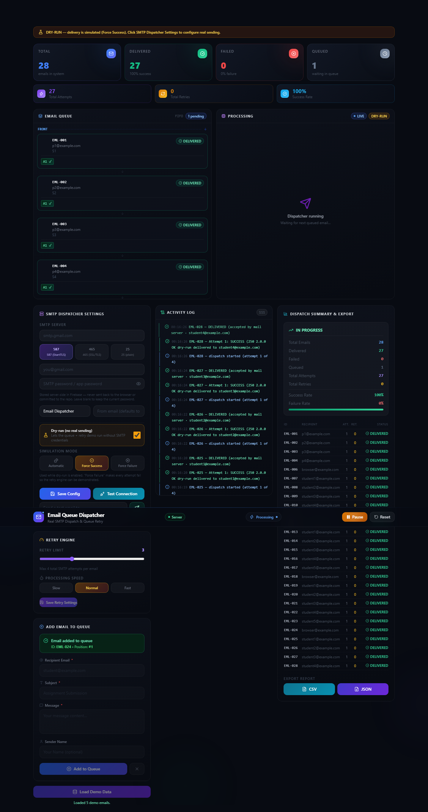
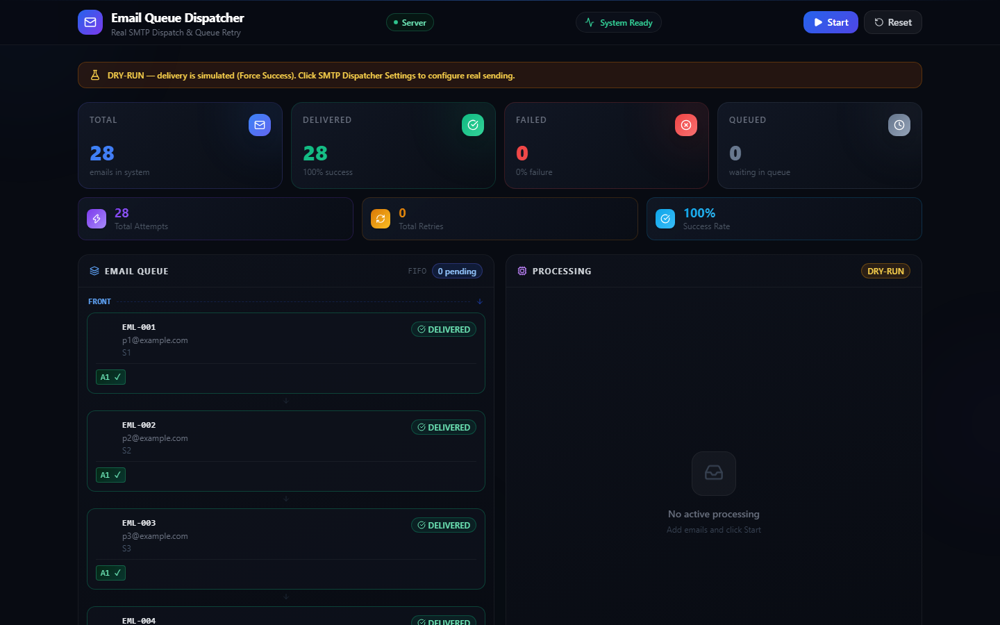
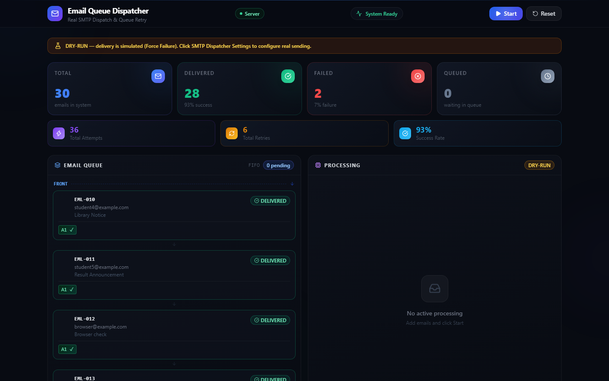
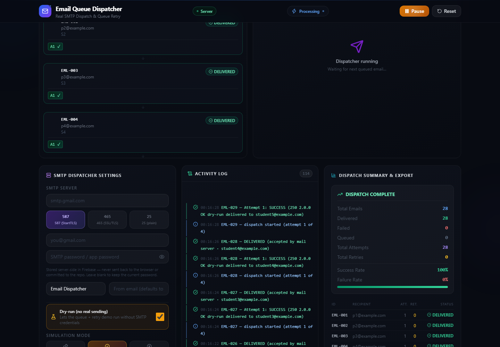
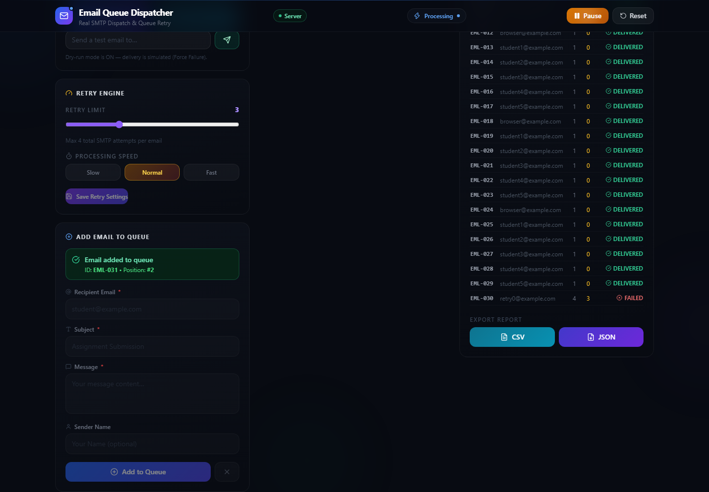
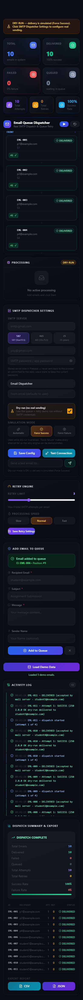

# Email Queue Dispatcher

> A **real SMTP email dispatcher** with a bounded retry engine.
> React + TypeScript (Vite) in the browser, Firebase Cloud Functions + Firestore +
> Nodemailer on the server.
>
> Add emails → the dispatcher drains them **FIFO** → sends them over **real SMTP** →
> the delivery status of every attempt streams back live → failures are retried
> automatically → the whole run is exportable as a report.

[](LICENSE)
[](https://github.com/IMTTY-ok/simple-email-queue-dispatcher/actions/workflows/ci.yml)


---

## Table of contents

1. [What it does](#1-what-it-does)
2. [Screenshots](#2-screenshots)
3. [The five modules](#3-the-five-modules)
4. [Tech stack](#4-tech-stack)
5. [Quick start — 5 minutes](#5-quick-start--5-minutes)
6. [Configuration — what to fill in, and why](#6-configuration--what-to-fill-in-and-why)
7. [How to use the dashboard](#7-how-to-use-the-dashboard)
8. [Deploying](#8-deploying)
9. [Project structure](#9-project-structure)
10. [How the dispatcher works](#10-how-the-dispatcher-works)
11. [API reference](#11-api-reference)
12. [Data model](#12-data-model)
13. [Testing](#13-testing)
14. [Scripts](#14-scripts)
15. [Troubleshooting](#15-troubleshooting)
16. [Security](#16-security)
17. [Contributing](#17-contributing)
18. [License](#18-license)

---

## 1. What it does

```
   ┌──────────────────────────┐   realtime listeners   ┌────────────────────────┐
   │  React dashboard         │◄───────────────────── │  Firestore             │
   │  :5173                   │  emails · activity ·  │  emails · activity ·   │
   │  useEmailDispatcher hook │  stats · _meta        │  stats · _meta         │
   └───────────┬──────────────┘                       └───────────▲────────────┘
               │  REST /api/*                                       │ Admin SDK writes
               ▼                                                   │
   ┌──────────────────────────┐                        ┌────────────────────────┐
   │  Cloud Function          │──── SMTP (250 / 550)───►│  Your mail server      │
   │  `backend`               │                        │  Gmail · Outlook · …   │
   │  Express + Nodemailer    │◄───────────────────────│                        │
   └──────────────────────────┘   550 / timeout        └────────────────────────┘
```

The queue is strictly FIFO, every attempt is recorded, and a failed delivery is
retried up to a configurable limit before it is marked `FAILED`.

---

## 2. Screenshots

| Dashboard | Queue & processing | Dispatch in progress |
| --- | --- | --- |
|  |  |  |
| Live counters, the dry-run/live banner, and the whole board | FRONT → REAR queue, per-attempt badges | The retry engine working through a failed attempt |

| Activity log | Dispatch summary & export | Phone width |
| --- | --- | --- |
|  |  |  |
| Every transition, colour-coded and timestamped | Statistics, results table, CSV/JSON export | The same dashboard at 390 px |

More captures live in [`docs/screenshots/`](docs/screenshots/).

---

## 3. The five modules

The application is organised into the five modules of the product requirements
document. Each module owns its own UI, its own client hook and — where it needs
one — its own server-side service. The frontend and the backend use the same
folder names, so a feature is easy to follow across the whole stack.

### 1 · Email Queue Creator

*Responsible for creating and storing email tasks.*

- Add an email with a validated recipient, subject and message
- Unique IDs are generated automatically (`EML-001`, `EML-002`, …)
- The queue position of a new email is reported back immediately
- Empty emails are refused; the form clears after a successful add
- The FIFO queue is visualised from FRONT to REAR, and a queued email can be removed

`src/modules/module-1-email-queue-creator/` · `functions/src/modules/module-1-email-queue-creator/`

### 2 · Send Simulator

*Determines whether a delivery attempt succeeds or fails.*

- **Real SMTP** through Nodemailer — Gmail (App Password), Outlook, Zoho, any relay
- **Dry-run simulator** with the three modes:
  - `AUTOMATIC` — pseudo-random success/failure
  - `FORCE_SUCCESS` — every attempt succeeds
  - `FORCE_FAILURE` — every attempt fails, so the retry engine can be demonstrated
- *Test Connection* and *Send a test email* validate the credentials before you dispatch

`src/modules/module-2-send-simulator/` · `functions/src/modules/module-2-send-simulator/`

### 3 · Retry Logic Engine

*The main logic of the project.*

- A failed email is retried up to `retryLimit` times
- `retryLimit = 3` → 1 initial attempt + 3 retries = **4 total attempts**
- The limit is configurable from the dashboard (0–10) and is clamped server-side
- Backoff between attempts, plus a processing speed (Slow / Normal / Fast)
- Start / Pause / Resume / Stop / Reset — pausing is cooperative and requeues the
  in-flight email, so nothing is ever stranded off-queue

`src/modules/module-3-retry-logic/` · `functions/src/modules/module-3-retry-logic/`

### 4 · Final Status Logger

*Maintains the complete history of every email.*

- Every attempt is appended to the email document: attempt number, result, detail, timestamp
- Every transition is written to a global activity log, rendered live in the dashboard
- The final status (`DELIVERED` / `FAILED`) and the retry count are recorded per email

`src/modules/module-4-final-status-logger/` · `functions/src/modules/module-4-final-status-logger/`

### 5 · Summary Exporter

*Summary dashboard and an exportable dispatch report.*

- Live statistics: total, queued, sending, delivered, failed, attempts, retries, success/failure rate
- A results table with the final status of every processed email
- Export the whole report as **CSV** or **JSON**, including the SMTP response and
  the error detail of every attempt

`src/modules/module-5-summary-exporter/` · `functions/src/modules/module-5-summary-exporter/`

---

## 4. Tech stack

| Layer | Technology | Why |
| --- | --- | --- |
| Frontend | React 19 + TypeScript 6 | Component model with full type safety over the whole domain model |
| Build tool | Vite 8 | Instant dev server, and a production build in under a second |
| Styling | Tailwind CSS 3 | One consistent design system without a CSS-in-JS runtime |
| Icons | Lucide React | Tree-shakeable, consistent icon set |
| State | React hooks | The dashboard is a single page driven by one realtime stream — no store needed |
| Realtime data | Firestore `onSnapshot` | The server pushes state; the client never polls |
| Backend | Cloud Functions (Node 20) + Express 4 | One HTTPS function hosting the whole API |
| Database | Cloud Firestore (Admin SDK) | The queue survives restarts and cold starts |
| Email transport | Nodemailer 10 | Works with Gmail, Outlook, Zoho, any SMTP relay |
| Linting | oxlint | Fast, and no ESLint config to maintain |
| Testing | Node's built-in test runner | No test-framework dependency to install |

---

## 5. Quick start — 5 minutes

### Prerequisites

- **Node.js 22.12 or newer** — check with `node --version`
- An SMTP account — *only* if you want to send real email. Dry-run mode needs none.
  For Gmail: enable 2FA → **App Password** at
  `myaccount.google.com → Security → App passwords`.

### Install

```bash
git clone https://github.com/IMTTY-ok/simple-email-queue-dispatcher.git
cd simple-email-queue-dispatcher

npm install          # the dashboard
npm run dev:setup    # the Cloud Function (installs functions/ dependencies)
```

### Run

```bash
npm run dev
```

That single command starts **two** things side by side:

| What | Where | What it is |
| --- | --- | --- |
| The dashboard | <http://localhost:5173> | Vite dev server, hot reload |
| The backend + database | <http://127.0.0.1:5001/email-dispatcher-43118/us-central1/backend> | Firebase emulator |
| Emulator UI | <http://localhost:4000> | Inspect the Firestore data live |

The Vite dev server proxies `/api/*` to the emulator, so **you need no
environment variables for local development**. Open
<http://localhost:5173> and you should see the dashboard with a green
**Server** badge.

> The emulator needs a moment on first run while it downloads the Firestore
> binary. If the function fails to appear, see
> [Troubleshooting](#15-troubleshooting).

### Try it in 30 seconds

1. Click **Load Demo Data** — five sample emails enter the queue.
2. Click **Start** — the queue drains from FRONT to REAR and the counters move.
3. Watch the **Activity Log** — every transition is logged live.

Nothing was really sent, because the demo project runs in **dry-run** mode. See
[How to use the dashboard](#7-how-to-use-the-dashboard) to send real email.

---

## 6. Configuration — what to fill in, and why

Everything configurable lives in exactly two places, plus one file you edit once.

### 6.1 `.firebaserc` — which Firebase project you use

```json
{
  "projects": {
    "default": "email-dispatcher-43118"
  }
}
```

| Field | What to fill in | Why you need it |
| --- | --- | --- |
| `default` | Your own Firebase project id (from the Firebase console → Project settings → Project ID) | The emulator, the CLI and the dev-server proxy all resolve the backend through this id. **Change this one field and the whole stack retargets** — you do not need to touch `vite.config.ts`. |

Leave it as-is to use the bundled demo project.

### 6.2 `.env.local` — the dashboard (browser side)

Copy the template and fill it in:

```bash
cp .env.example .env.local
```

| Variable | Required? | What to fill in | Why you need it |
| --- | --- | --- | --- |
| `VITE_API_URL` | **for deployments only** | `https://us-central1-<your-project>.cloudfunctions.net/backend` | Tells the browser where the API lives. Leave it **unset locally** — the dev proxy already forwards `/api` to the emulator. |
| `VITE_FIREBASE_API_KEY` | only with your own project | Firebase console → Project settings → Your apps → *SDK setup and configuration* → `apiKey` | The browser needs to identify the project in order to open the realtime listeners. It is a **public identifier**, not a secret — it is also readable from the shipped JavaScript. |
| `VITE_FIREBASE_AUTH_DOMAIN` | only with your own project | Same screen → `authDomain` (`<project>.firebaseapp.com`) | Required by the Firebase SDK to initialise. |
| `VITE_FIREBASE_PROJECT_ID` | only with your own project | Same screen → `projectId` | Selects the project the SDK talks to. Leave unset to use the value from `.firebaserc`. |
| `VITE_FIREBASE_STORAGE_BUCKET` | only with your own project | Same screen → `storageBucket` | Required by the SDK initialiser, even if you never use Storage. |
| `VITE_FIREBASE_MESSAGING_SENDER_ID` | only with your own project | Same screen → `messagingSenderId` | Same — the SDK expects the full config object. |
| `VITE_FIREBASE_APP_ID` | only with your own project | Same screen → `appId` | Identifies your web app inside the project. |
| `VITE_FIREBASE_MEASUREMENT_ID` | optional | Same screen → `measurementId` | Only used for Google Analytics. Leave blank to disable analytics. |

> **Never** put an SMTP password or a service-account key in a `VITE_` variable.
> Everything prefixed with `VITE_` is compiled into the browser bundle in plain
> text.

### 6.3 `functions/.env` — the backend (server side)

```bash
cp functions/.env.example functions/.env
```

The emulator reads this file automatically. `functions/.env` is gitignored.

| Variable | Required? | What to fill in | Why you need it |
| --- | --- | --- | --- |
| `SMTP_HOST` | for real sending | Your provider's server, e.g. `smtp.gmail.com` | The hostname the dispatcher connects to. |
| `SMTP_PORT` | for real sending | `587` (StartTLS) or `465` (implicit SSL) | Most providers want `587`; `465` is for implicit SSL. `25` is plaintext and almost never right. |
| `SMTP_SECURE` | for real sending | `false` with port 587, `true` with port 465 | Tells Nodemailer whether to wrap the socket in TLS immediately. |
| `SMTP_USER` | for real sending | The mailbox you log in with | The SMTP username. Usually the full address. |
| `SMTP_PASS` | for real sending | The app password / API token | **The only secret in the project.** Use an *app password*, never your account password. |
| `FROM_EMAIL` | recommended | The address recipients see | Defaults to `SMTP_USER`. Some providers refuse to send from an address they do not own. |
| `FROM_NAME` | optional | A friendly display name, e.g. `Email Dispatcher` | Shown in the recipient's inbox next to the address. |
| `RETRY_LIMIT` | optional | `3` (the default) | How many times a failed attempt may be repeated. The maximum number of attempts is this value **+ 1**. |
| `RETRY_DELAY_MS` | optional | `3000` | How long to wait before the next attempt. Give a real mail server room to recover from a transient failure. |
| `INTER_EMAIL_DELAY_MS` | optional | `1200` | The pause between two consecutive emails. Keeps you under most providers' rate limits. |
| `SMTP_DRYRUN` | optional | `true` to simulate, `false` to send for real | The safety switch. Leave it `true` while you are setting things up. |
| `SIMULATION_MODE` | optional | `AUTOMATIC`, `FORCE_SUCCESS` or `FORCE_FAILURE` | Only used while dry-run is on. `FORCE_FAILURE` is how you demonstrate the retry engine without breaking a real mailbox. |
| `ALLOWED_ORIGIN` | **for deployments** | `https://your-frontend.example.com` | Which browser origins may change state. See below — this one bites. |

### 6.4 `ALLOWED_ORIGIN` — the one setting people get wrong

State-changing requests (`POST`, `PUT`, `PATCH`, `DELETE`) are refused with
**403** unless the browser's `Origin` header is in the allowlist. Reads are
always open.

| Situation | What to set |
| --- | --- |
| Local development | Nothing — the built-in default already covers `localhost:5173`, `localhost:4173` and the emulator UI. |
| Your own deployment | The exact origin of your deployed dashboard, e.g. `https://email-queue-dispatcher.vercel.app`. Several origins → comma-separated: `https://a.app,https://b.app`. |
| A domain you cannot change | Use the value the browser sends — the scheme and host, **without** a trailing slash and **without** a path. |

**Symptom of a wrong value:** the dashboard loads and the counters work, but
Start / Save / Add do nothing and the banner shows *"Origin not allowed"*. Fix
`ALLOWED_ORIGIN` on the function and reload.

### 6.5 `firebase.json`, `firestore.rules`, `firestore.indexes.json`

These are committed and need no editing to run locally.

| File | What it does | Why it matters |
| --- | --- | --- |
| `firebase.json` | Points the CLI at `functions/`, the rules and the indexes, and declares the emulator ports | The single place that ties the project together |
| `firestore.rules` | The browser may only **read**; every write goes through the Cloud Function. `_secrets/*` is denied to browsers entirely | This is why the SMTP password can never leak into the client. It is also the app's main security boundary — read the [Security](#16-security) section |
| `firestore.indexes.json` | The composite index the FIFO query needs (`status` + `seq`) | Without it Firestore rejects the "next queued email" query |

---

## 7. How to use the dashboard

### The header

| Control | What it does |
| --- | --- |
| **Start** | Begins dispatching the queue. Becomes **Resume** while paused. |
| **Pause** | Stops after the current attempt. The in-flight email is **requeued**, so nothing is lost. |
| **Reset** | Clears the queue, the activity log and the statistics. Asks for confirmation while a dispatch is live. |
| **Server / Offline** badge | Green means the realtime connection to the backend is healthy. |

### The mode banner

The thin banner under the header tells you what will actually happen:

- **DRY-RUN — delivery is simulated (Force Success)** — nothing leaves your machine.
  Perfect for a demo or for setting the app up.
- **LIVE — emails are sent for real via SMTP to `host:port`** — real email is being sent.
  Check this line before you press Start.

### Adding email

Fill in **Recipient Email**, **Subject** and **Message**; *Sender Name* is optional.
The form validates before sending and clears itself afterwards. The confirmation
shows the new email's ID and its queue position.

### The queue panel

Every email is listed from **FRONT** (processed next) to **REAR** (processed last).
Only *pending* emails carry a queue position — finished ones show their final
status and their per-attempt badges (`A1 ✓`, `A2 ✗`, …).

### The settings panel

Fill in the SMTP server, port and credentials, then press **Save Config**.
*Test Connection* opens a socket and authenticates without sending anything;
*Send a test email* additionally delivers a real message to the address you type.

Enable **Dry-run** to simulate. While dry-run is on, the **Simulation Mode**
buttons become active:

| Mode | What happens on each attempt |
| --- | --- |
| `Automatic` | Succeeds about 60 % of the time — good for showing a mixed run |
| `Force Success` | Always succeeds |
| `Force Failure` | Always fails — **use this to demonstrate the retry engine** |

The **Retry Engine** panel sets the retry limit and the processing speed. Press
**Save Retry Settings** for them to take effect.

### Dispatching

Press **Start**. The Processing panel shows the email currently being sent, the
attempt counter, a progress bar and the full attempt history. The Activity Log
on the right records every transition, newest first.

If you pause mid-run, the current email goes back to the queue with its attempt
history intact — so pausing can never buy an email extra retries.

### Exporting

The **Dispatch Summary & Export** panel lists every processed email with its
final status. **CSV** gives you a spreadsheet of the run; **JSON** gives you the
complete report including the summary statistics, the SMTP response and the error
detail of every attempt.

---

## 8. Deploying

### The backend

```bash
npm run build                       # build the dashboard first (see below)
firebase deploy --only functions,firestore
```

Before the first deploy, make sure the function knows where the browser comes from:

```bash
# either as an environment variable on the function...
firebase functions:config:set    # or set ALLOWED_ORIGIN in the function's environment
```

And keep the SMTP password **out** of any committed file:

```bash
firebase functions:secrets:set SMTP_PASS
```

### The dashboard

Build it with `VITE_API_URL` pointing at the deployed function:

```bash
VITE_API_URL=https://us-central1-<your-project>.cloudfunctions.net/backend npm run build
```

The output in `dist/` is a plain static bundle — serve it from Vercel, Netlify,
Firebase Hosting, GitHub Pages or any web server.

> When you deploy to a different origin, add that origin to `ALLOWED_ORIGIN` on
> the function **before** you test the buttons.

---

## 9. Project structure

```
simple-email-queue-dispatcher/
│
├── src/                                   # Frontend (React + TypeScript)
│   ├── App.tsx                            # page layout — composes the five modules
│   ├── main.tsx                           # entry point
│   ├── index.css                          # Tailwind layers + the design system
│   │
│   ├── modules/
│   │   ├── module-1-email-queue-creator/  # Module 1
│   │   │   ├── components/
│   │   │   │   ├── AddEmailForm.tsx       # validated "add to queue" form
│   │   │   │   ├── DemoDataButton.tsx     # loads the five demo emails
│   │   │   │   ├── QueuePanel.tsx         # FRONT → REAR visualisation
│   │   │   │   └── QueueItem.tsx          # status badge, attempt badges, remove
│   │   │   └── hooks/useQueueActions.ts   # enqueue / remove / demo data
│   │   │
│   │   ├── module-2-send-simulator/       # Module 2
│   │   │   ├── components/SettingsPanel.tsx  # SMTP config + simulation mode
│   │   │   └── hooks/useSimulatorConfig.ts   # save / test connection / test send
│   │   │
│   │   ├── module-3-retry-logic/          # Module 3
│   │   │   ├── components/
│   │   │   │   ├── ProcessingPanel.tsx    # live attempt + attempt history
│   │   │   │   └── RetrySettingsPanel.tsx # retry limit + processing speed
│   │   │   └── hooks/useDispatchControls.ts # start / pause / resume / reset
│   │   │
│   │   ├── module-4-final-status-logger/  # Module 4
│   │   │   └── components/ActivityLog.tsx # the live activity log
│   │   │
│   │   └── module-5-summary-exporter/     # Module 5
│   │       ├── components/
│   │       │   ├── StatsCards.tsx         # animated counters
│   │       │   └── ExportPanel.tsx        # summary, results table, export
│   │       └── utils/exportReport.ts      # CSV / JSON serialisation
│   │
│   └── shared/                            # used by more than one module
│       ├── api/client.ts                  # apiUrl() + the JSON fetch helper
│       ├── components/Header.tsx          # app chrome + dispatch controls
│       ├── constants.ts                   # ports, simulation modes, demo data
│       ├── hooks/
│       │   ├── useDashboardData.ts        # the Firestore realtime listeners
│       │   └── useEmailDispatcher.ts      # wires the state to the five modules
│       ├── lib/firebase.ts                # centralised Firebase initialisation
│       ├── mappers.ts                     # Firestore/REST → domain types
│       ├── types/email.ts                 # the shared domain model
│       └── utils/format.ts                # formatting + validation helpers
│
├── functions/                             # Backend (Cloud Functions)
│   ├── index.js                           # HTTPS bootstrap, CORS, rate limit
│   ├── .env.example
│   └── src/
│       ├── routes.js                      # the REST API
│       ├── modules/
│       │   ├── module-1-email-queue-creator/queue.js
│       │   ├── module-2-send-simulator/simulator.js
│       │   ├── module-3-retry-logic/dispatch.js
│       │   ├── module-4-final-status-logger/logger.js
│       │   └── module-5-summary-exporter/summary.js
│       └── shared/
│           ├── config.js                  # env + Firestore config layering
│           ├── http.js                    # ok / fail / async handler wrapper
│           └── store.js                   # Firestore data-access layer
│
├── tests/                                 # unit tests, one file per module
├── scripts/
│   ├── integration-check.mjs              # end-to-end check against the emulator
│   ├── browser_check.py                   # browser smoke test + screenshots
│   └── responsive_check.py                # layout / accessibility sweep
│
├── docs/screenshots/                      # the images used above
│
├── firestore.rules                        # browser: read-only, writes denied
├── firestore.indexes.json                 # composite index for the FIFO query
├── firebase.json                          # functions + rules + emulator ports
├── .firebaserc                            # which Firebase project to use
├── vite.config.ts                         # /api → emulator proxy, code splitting
└── package.json
```

---

## 10. How the dispatcher works

```
claim the dispatch lease                 (only one live pass at a time)
reap emails stranded by a dead invocation
PASS BUDGET = 420s

WHILE inside the budget:
    stop if paused / stopped
    renew the lease
    take the front queued email            (FIFO, by seq)
    mark it SENDING
    attempt = last used attempt + 1
    WHILE attempt <= retryLimit + 1
        send over SMTP
        IF accepted (250)   → log SUCCESS → mark DELIVERED → next email
        ELSE                → log FAILURE
                               IF last attempt → mark FAILED → next email
                               ELSE → mark RETRYING → backoff(retryDelayMs)
        stop if paused → requeue the email → exit the pass
    pace(interEmailDelayMs)

release the lease → { done, remaining }   (the dashboard calls /continue if needed)
```

Cloud Functions are ephemeral, so the engine runs as a **bounded dispatch pass**
rather than one endless loop. The dashboard keeps a pass alive by calling
`POST /api/dispatch/continue` while work remains.

Two details worth knowing:

- **The dispatch lease** guarantees that only one invocation sends at a time, so
  two browser tabs can never send the same email twice.
- **The stale sweep** reclaims emails left behind by a killed invocation and
  requeues them.

---

## 11. API reference

All endpoints live under the Cloud Function base URL.

| Method | Endpoint | Module | Purpose |
| --- | --- | --- | --- |
| GET | `/api/health` | — | service health, dispatcher state, statistics |
| GET | `/api/config` | 2 | read the SMTP + dispatcher configuration |
| POST | `/api/config` | 2 | update the SMTP + dispatcher configuration |
| POST | `/api/config/test` | 2 | verify the SMTP connection |
| POST | `/api/config/test-send` | 2 | send an immediate test email |
| GET | `/api/emails` · `/api/emails/:id` | 1 | all emails / one email |
| POST | `/api/emails` · `/api/emails/batch` | 1 | enqueue one / many emails |
| DELETE | `/api/emails/:id` | 1 | remove an email from the queue |
| GET | `/api/activity` | 4 | the activity log |
| GET | `/api/stats` | 5 | live statistics |
| GET | `/api/report` | 5 | the full dispatch report (summary + rows) |
| POST | `/api/dispatch/start`·`continue`·`pause`·`resume`·`stop`·`reset` | 3 | dispatcher lifecycle |

Live dashboard data is **not** polled — it arrives through Firestore
`onSnapshot` listeners.

Example:

```bash
curl -X POST http://127.0.0.1:5001/email-dispatcher-43118/us-central1/backend/api/emails \
  -H 'Content-Type: application/json' \
  -H 'Origin: http://localhost:5173' \
  -d '{"recipient":"student@example.com","subject":"Hi","message":"Hello"}'
```

> The `Origin` header is required for every state-changing call — that is the
> origin guard described in [6.4](#64-allowed_origin--the-one-setting-people-get-wrong).

---

## 12. Data model

```typescript
interface Email {
  id: string;              // "EML-001"
  seq: number;             // monotonic insertion sequence (FIFO order)
  recipient: string;
  subject: string;
  message: string;
  senderName?: string | null;
  status: 'QUEUED' | 'SENDING' | 'RETRYING' | 'DELIVERED' | 'FAILED';
  attempts: number;        // SMTP attempts made
  retries: number;         // attempts - 1
  retryLimit: number;
  createdAt: string;
  updatedAt: string;
  finalStatus: 'DELIVERED' | 'FAILED' | null;
  socketErr: string | null;               // last delivery error, if FAILED
  smtp: { accepted: string[]; response: string; messageId: string } | null;
  logs: { attempt: number; result: 'SUCCESS' | 'FAILURE'; detail?: string; timestamp: string }[];
}
```

Firestore layout:

| Collection / document | Contents |
| --- | --- |
| `emails` | One document per queued email, including its attempt history |
| `activity` | The global activity log (newest first, bounded to 250 entries) |
| `stats/main` | The counters behind the dashboard's statistics |
| `_meta/main` | The dispatcher state (`running`, `paused`) and the sequence counters |
| `_config/main` | The dashboard-editable configuration (no secrets) |
| `_secrets/main` | The SMTP password — **denied to browsers by the Firestore rules** |

---

## 13. Testing

```bash
npm test                      # 40 unit tests, one file per module
npm run test:integration      # 62 assertions against the running emulator
npm run lint                  # oxlint over src, functions, tests and scripts
npm run typecheck             # tsc -b
```

The unit tests cover the pure logic of each module: the queue validation rules,
the three simulation modes and the dry-run transport, the attempt budget and
progress maths, the status → counter mapping, and the CSV/JSON exporters.

The integration check exercises all five modules over the real HTTP API against
the emulator — including the failure/retry path, pause/resume, email removal and
the origin guard.

```bash
npm run dev                   # in one terminal
npm run test:integration      # in another
```

Two optional browser checks (they need `pip install playwright` and
`playwright install chromium`):

```bash
python scripts/browser_check.py     # renders the dashboard, captures the screenshots
python scripts/responsive_check.py  # layout + accessibility sweep over 4 breakpoints
```

---

## 14. Scripts

| Script | Purpose |
| --- | --- |
| `npm run dev` | Firebase emulators + Vite dev server (concurrently) |
| `npm run dev:web` | Vite dev server only |
| `npm run dev:emulators` | Functions + Firestore emulators only |
| `npm run dev:setup` | `npm install --prefix functions` |
| `npm run build` | `tsc -b` + production Vite build |
| `npm run typecheck` | TypeScript project build (types only) |
| `npm run lint` | oxlint |
| `npm test` | unit tests |
| `npm run test:integration` | end-to-end check against the emulator |
| `npm run preview` | preview the production build |

---

## 15. Troubleshooting

| Symptom | Cause | Fix |
| --- | --- | --- |
| *"Dispatcher data source unreachable"* banner | The emulators are not running | Run `npm run dev` (not `npm run dev:web` alone) and wait for *"All emulators ready"* |
| *"Function us-central1-backend does not exist"* | The function failed to load on first run — the emulator gave up after 10 s while downloading its runtime | Stop everything and start again; the first run is slow, later runs are not. `FUNCTIONS_DISCOVERY_TIMEOUT=300` is already set by `npm run dev:emulators` |
| *"Could not start Firestore Emulator, port taken"* | Another process holds port 8080 | Close the other emulator (`firebase emulators:stop`) or change the port in `firebase.json` |
| *"Origin not allowed"* | The browser's origin is not in `ALLOWED_ORIGIN` | See [6.4](#64-allowed_origin--the-one-setting-people-get-wrong) |
| The dashboard loads but Start does nothing | Same as above — reads work, writes are refused | Fix `ALLOWED_ORIGIN` |
| *"SMTP is not configured"* when pressing Start | Dry-run is off and no host is set | Fill in the SMTP settings, or tick **Dry-run** |
| *"No emails in the queue"* | The queue is empty | Add an email or press **Load Demo Data** |
| *"Please enter a valid email address."* | The recipient failed validation | Use a full address, e.g. `student@example.com` |
| Emails always fail with `535` / `535 5.7.8` | The provider rejects the login | You are most likely using your account password — generate an **app password** |
| The git history shows the demo project's data | `firestore.rules` allows anonymous reads | See [Security](#16-security) before putting real recipients in the queue |

---

## 16. Security

- **The SMTP password never reaches the browser.** It lives in Firestore under
  `_secrets/main`, which the Firestore rules deny to browsers, or in a Firebase
  secret. The API only ever returns a `hasPassword` boolean.
- **Only the Cloud Function writes.** The browser is read-only in Firestore, and
  the rules deny every unmatched path.
- **State-changing requests must come from an allowed origin.** `POST`, `PUT`,
  `PATCH` and `DELETE` are refused with `403` unless the `Origin` header is in
  the `ALLOWED_ORIGIN` allowlist. This stops a third-party website from driving
  the dispatcher through a visitor's browser.
- **Rate limiting** — 60 state-changing requests per minute per IP.
- **Payload limits** — request bodies are capped at 100 kB and a batch may hold
  at most 100 emails.
- **No secrets in the repository.** `.env`, `*.pem`, `*key*` and service-account
  files are all in `.gitignore`.
- **The Firebase web configuration is public by design** — it identifies the
  project and is readable from the shipped JavaScript. The security boundary is
  the Firestore rules, not the API key. Set `VITE_FIREBASE_*` to use your own
  project.

> **Before using this with real recipients:** the dashboard currently reads the
> queue anonymously, so anyone who knows the project id can read the queued
> email content. Enable Firebase Authentication and change
> `allow read: if true` to `allow read: if request.auth != null` in
> `firestore.rules` if that matters to you.

---

## 17. Contributing

Contributions are welcome.

1. Fork the repository and create a branch:
   `git checkout -b feature/your-change`
2. Install the dependencies: `npm install && npm run dev:setup`
3. Make your change — keep the five module boundaries intact: a feature that
   belongs to a module lives in that module's directory, on **both** the frontend
   and the backend.
4. Verify it:

   ```bash
   npm run lint && npm run typecheck && npm test
   npm run dev              # in one terminal
   npm run test:integration # in another
   ```

5. Commit with a clear message and open a pull request describing the change and
   how you verified it.

Please do not commit `node_modules`, `dist`, `.env` files, logs or any
credential.

---

## 18. License

MIT — free to use for educational purposes. See [LICENSE](LICENSE).

---

> Built by [Imtty](https://github.com/IMTTY-ok) as a college project demonstration.
